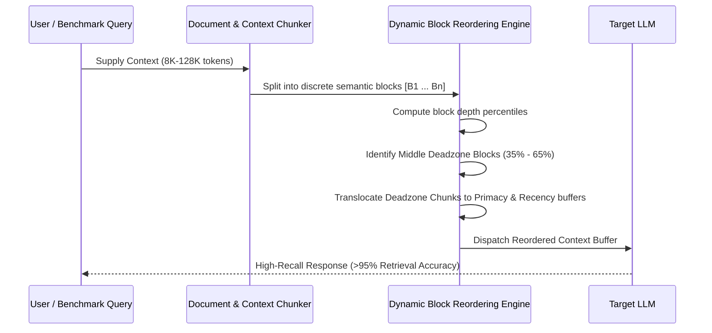

# Contexta System Architecture & Technical Specification

> **Contexta**: Context Optimization & Benchmarking Framework for Large Language Models

---

## 🏛️ System Overview

Contexta is engineered as a **dual-engine platform** combining empirical AI evaluation with real-time enterprise context optimization:

```mermaid
graph TD
    User([User / Evaluator]) --> UI[Modern React 18 + Tailwind Interface]
    
    subgraph UI_Layer [Application & Visualization Layer]
        UI --> BenchLab[🔬 Benchmark & Optimization Lab]
        UI --> ChatStudio[💬 Intelligent Chat Studio]
        UI --> CostDash[📊 Cost & Token Dashboard]
    end

    subgraph Core_Engines [Contexta Dual Engines]
        BenchLab --> BenchEngine[Benchmark Generation Engine]
        BenchEngine --> NeedleInj[Needle Injection & Depth Matrix]
        NeedleInj --> OptAlgorithms[Optimization Algorithms: DBR & SPS]
        
        ChatStudio --> DocProc[Document Extraction & Web Worker]
        ChatStudio --> ContextManager[Dynamic Token Budget Monitor]
        ContextManager --> AutoSumm[Auto-Summarization Pipeline (70% Threshold)]
    end

    subgraph State_Storage [Client-Side State & Storage Layer]
        Store1[Zustand conversationStore]
        Store2[Zustand settingsStore]
        Store3[Zustand documentStore]
        Store4[Zustand uiStore]
        
        Store1 --> IDB[(IndexedDB: Documents & Large Payloads)]
        Store2 --> EncryptedStorage[(AES-GCM 256-bit Encrypted LocalStorage)]
    end

    subgraph Multi_Model_Gateway [Model Execution Gateway]
        OptAlgorithms --> APIGateway[Multi-Model API Adapter]
        ChatStudio --> APIGateway
        
        APIGateway --> OpenAI[OpenAI API (GPT-4o, o1)]
        APIGateway --> Anthropic[Anthropic API (Claude 3.5)]
        APIGateway --> Google[Google Gemini API (1.5 Pro/Flash)]
        APIGateway --> Ollama[Local Ollama (Llama 3, Mistral)]
    end
```

---

## 📂 Directory Structure

```plaintext
Contexta/
├── docs/                                  # In-depth architectural & benchmark documentation
│   ├── BENCHMARK_AND_OPTIMIZATION.md      # Algorithm specifications & Lost-in-the-Middle theory
│   └── SETUP_AND_ENV.md                   # Environment setup & model provider guides
├── public/                                # Static assets & Web Workers
│   └── pdf.worker.min.mjs                 # Offline PDF text extraction worker
├── src/
│   ├── components/                        # UI Component Hierarchy
│   │   ├── benchmark/                     # Evaluation Lab Components
│   │   │   ├── BenchmarkLab.tsx           # Benchmark control center
│   │   │   ├── BlockOrderVisualizer.tsx   # Visual comparison of raw vs reordered memory
│   │   │   ├── EvaluationReportModal.tsx  # Academic PDF/JSON export modal
│   │   │   ├── LiveProbeModal.tsx         # Real-time multi-model evaluation runner
│   │   │   └── NeedleHeatmap.tsx          # 2D Depth vs Context Length interactive heatmap
│   │   ├── chat/                          # Chat conversation elements
│   │   ├── cost/                          # Real-time cost & token analytics
│   │   ├── documents/                     # Document ingestion & management
│   │   ├── research/                      # Academic citation & reference parser
│   │   ├── settings/                      # Model & API settings with live testing
│   │   ├── sidebar/                       # Conversation navigation & branching tree
│   │   └── ui/                            # Shadcn UI accessible primitive library
│   ├── features/                          # Feature modules & integration tests
│   ├── hooks/                             # Custom hooks (AppState, Shortcuts, Mobile)
│   ├── lib/                               # Core utilities
│   │   ├── citationParser.ts              # Citation & reference mapping
│   │   ├── security.ts                    # Web Crypto API AES-GCM encryption & validation
│   │   └── utils.ts                       # Classnames and formatting helpers
│   ├── services/                          # Business logic & algorithms
│   │   ├── api.ts                         # Multi-provider unified LLM gateway
│   │   ├── costService.ts                 # Real-time pricing calculation
│   │   ├── documentProcessor.ts           # PDF and TXT text extraction
│   │   ├── exportService.ts               # Conversation & benchmark export
│   │   ├── storage.ts                     # Encrypted local persistence
│   │   ├── summarizer.ts                  # Multi-style automatic context compressor
│   │   ├── tokenCounter.ts                # Token tracking & estimation
│   │   └── benchmark/                     # Benchmark engine internals
│   │       ├── benchmarkData.ts           # Preloaded domain corpora (Legal, Research, Code)
│   │       ├── needleEngine.ts            # Synthetic needle injection
│   │       ├── optimizationAlgorithms.ts  # Dynamic Block Reordering & Semantic Prioritization
│   │       └── reportGenerator.ts         # Academic report exporter
│   ├── stores/                            # Zustand reactive state stores
│   │   ├── conversationStore.ts           # Messages, forks, branches
│   │   ├── documentStore.ts               # Ingested files & chunks
│   │   ├── settingsStore.ts               # Encrypted keys & provider configs
│   │   └── uiStore.ts                     # Modals, sidebars, active view
│   ├── types/                             # Comprehensive TypeScript type definitions
│   ├── App.tsx                            # Primary application shell
│   └── main.tsx                           # Application entrypoint
├── vitest.config.ts                       # Unit & integration testing configuration
├── tailwind.config.ts                     # Design system & theme tokens
├── vite.config.ts                         # Vite bundler configuration
└── package.json                           # Dependencies & project scripts
```

---

## ⚡ Core Technical Mechanisms

### 1. Dynamic Block Reordering (DBR)


### 2. Auto-Summarization Threshold Pipeline
```
[User Messages Stream] 
        │
        ▼
[Real-Time Token Monitor] ──── Token Usage < 70% ────► Continue Normal Stream
        │
        ▼ Token Usage ≥ 70% (Configurable Threshold)
[Compression Engine Activated]
        │
        ├── 1. Partition: Preserve Last N Messages (Default: 10)
        ├── 2. Extract: Previous Conversation Chunk
        ├── 3. Compress: LLM Summarization (Structured, Concise, Academic, or Narrative)
        └── 4. Consolidate: Inject Compact Context Summary Card
        │
        ▼
[Context Reclaimed: ~60% Memory Buffer Freed]
```

### 3. Cryptographic Security Model
- **Zero Server Exposure**: All API keys, conversations, and document chunks are maintained locally on the client.
- **AES-GCM Encryption**: API keys are encrypted using Web Crypto `AES-GCM` (256-bit) with PBKDF2 key derivation and random initialization vectors (IVs).
- **Prompt Sanitization**: Inputs are sanitized against prompt injection patterns before dispatch to external model endpoints.

---

## 📊 Performance Standards & Benchmarks

| Metric | Target | Current Status |
|--------|--------|----------------|
| **Test Coverage** | Unit + Integration | 26/26 Tests Passing (100%) |
| **Vite Bundle Time** | < 10 seconds | 6.51 seconds |
| **PDF Extraction (50 Pages)** | < 1,500 ms | Handled off-thread in Web Worker |
| **Supported Context Windows** | 8K to 128K+ | Supported (8K, 16K, 32K, 64K, 128K) |
| **Model Providers** | 4 Major Families | OpenAI, Anthropic, Google Gemini, Ollama |
